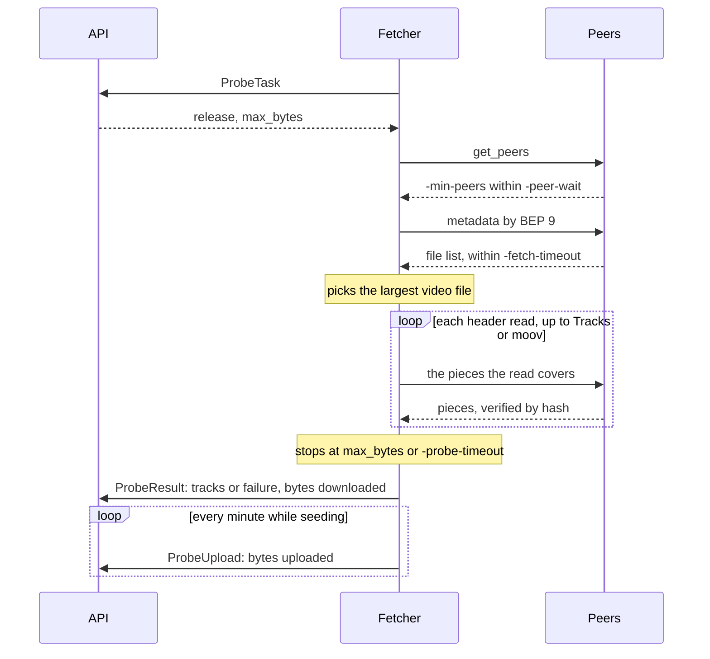
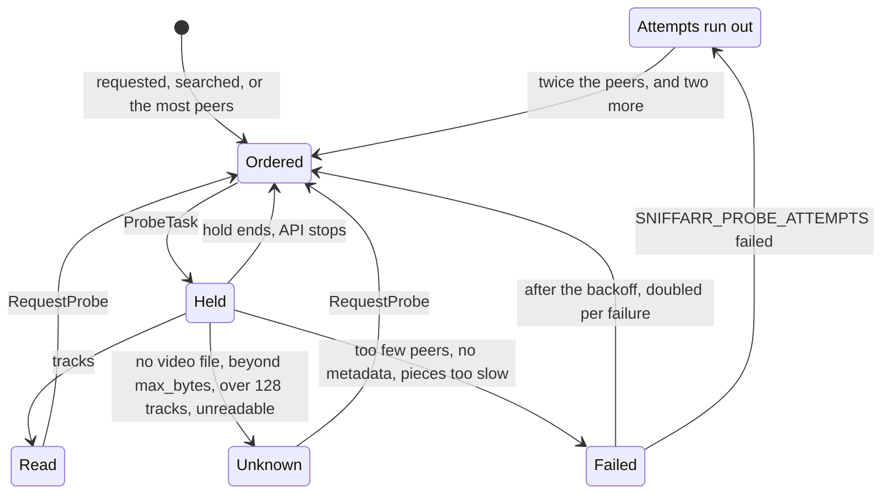

# Probes

A probe reads the track list of a stored release's main video file from its
container header, which lies in the file's first pieces. Probes are off
unless `-probe` is given: `-api` with it orders probes and hands out the
tasks, and `-fetch` with it takes them. Turn probes on by giving `-probe` to
the process that runs `-api` and to the fetchers that are to probe, with
`-probe-dir` naming where the pieces are kept; without `-probe-dir` they are
kept in a fresh temporary directory, removed at stop, so nothing seeded
survives a restart. The Helm chart's `probe.enabled` does both.

With probes off, Torznab searches order no probe, `RequestProbe` fails
with `FAILED_PRECONDITION`, `ProbeTask` hands out none, the API purges
`PROBE_ORDERS` at start, and `Settings` tells
the web UI, which hides its probe button, meter and queue. Tracks and
probabilities stored by earlier probes stay, in the Torznab titles too.

The fetcher finds the torrent's peers with `get_peers`, fetches its
metadata by BEP 9, and picks the largest file ending in `.mkv`, `.webm`,
`.mp4`, `.m4v` or `.mov`; for a season pack that is one episode. It reads
the file through the pieces each read covers, downloading them from the
peers and verifying each against its hash before reading it. In Matroska
and WebM it reads the EBML header and the Segment's top-level element
headers up to Tracks, reading no body but those of SeekHead and Tracks, and
follows SeekHead when Tracks comes after the first Cluster; in MP4 and MOV it reads the
top-level box headers up to `moov`. A probe that would download more than
the task's `max_bytes` stops there, and the tracks stay unknown, as they do
for a track list of more than 128 tracks, which the API takes from no
fetcher either. Of each
track it records the kind, the language as ISO 639-2 and as BCP-47, the
name, the codec, an audio track's channels, and a video track's size and
dynamic range: `DV` for a Dolby Vision configuration (Matroska's
BlockAdditionMapping, MP4's `dvcC`, `dvvC` or `dvwC`), else `HLG` or
`HDR10` by the transfer characteristics, or `HDR10` for mastering metadata.

Candidates are stored movies and series with a stored file of those
formats and at least one distinct peer over the last 7 days. Probes are
orders on the NATS stream `PROBE_ORDERS`, on a subject per priority, and the
API hands them out one to each `ProbeTask`, the highest priority first and
then the oldest order. Releases asked for with `RequestProbe`, the web UI's
probe button, are ordered at P0 and go first, whatever their last probe; a
request for a release with no file of those formats orders nothing.
Releases with peers that a Torznab search with a query or an ID returned are
ordered at P1, unless their probe is done or its failures ran out without
the peers growing; one waiting out the backoff of a failed probe is
ordered for the time it is due. Once a minute, while P3 holds no order, handed out or not,
the API orders at P3 the 64 releases never probed with the most peers over 7
days, then those due a probe again with the most. An order at P1 to P3 of a
release that is no longer due a probe when it comes out is dropped, as is
an order of a release whose probe is handed out already. Each release is
probed once, and
the outcome is stored, the tracks in their own table: read, unknown
(no file of those formats, a track list beyond `max_bytes` or of more than
128 tracks, or a header the probe cannot read), or failed (fewer than `-min-peers` peers within
`-peer-wait`, the metadata not within `-fetch-timeout`, or the pieces not
before `-probe-timeout`). The release's journal records each request, once a
day a search that ordered its probe, with the query, the first hand-out of
each order with the piece data it may download and when the hold ends,
and each outcome with the piece data downloaded, the first 32
tracks read with how many there were when more, the times the order was
handed out when that was more than once and, for a failure, whether the
attempts have run out and, when it waits out a backoff, when it is due
again. A failed probe is due again after `SNIFFARR_PROBE_BACKOFF`, doubled
for each failure before; one a request or a search ordered is ordered again
at P1 for that time, by a message scheduled on
`sniffarr.orders.probe.retry.<infohash>`. Once
`SNIFFARR_PROBE_ATTEMPTS` have failed since the release was last read, the
backoff stays at its last doubling and the release is probed again only once
it has twice the peers over 7 days it had at its last probe, and at least two
more. A prober holds a probe for `SNIFFARR_PROBE_LEASE`; then, or when the
API stops, the order goes back to the stream and is handed out again. A
result that comes after its order went back still records the probe.

The API meters the piece data probes download per UTC day, as it meters
the classifier's tokens: `SNIFFARR_PROBE_DAILY_BYTES`, 100 GiB by default.
A probe handed out counts as `SNIFFARR_PROBE_MAX_BYTES` until its result
reports what it downloaded. Orders at P3 stop at 75% of the day's bytes by
default, `SNIFFARR_PROBE_SEARCH_RESERVE` leaving the rest for requested and
searched ones.

With the audio extension on, a probe that read the tracks sets the
probability of an audio track in each configured language, under layer
`probe`: 1 when an audio track is in it; 0 when every audio track gives
another language, over a marker in the name too, unless the release has an
audio file of its own (`.mka`, `.ac3`, `.eac3`, `.dts`, `.aac`, `.flac`,
`.m4a`, `.mp3`, `.opus`, `.wav`), which may carry that audio. The Torznab
title follows the probability: `[NORUS …]` once the probe set 0, `[RUS]`
while the marker stands. A track that gives no language
leaves the probability as it was. The classifier does not override a probe. The
language's studios named in its tracks, as `MVO LostFilm`, join the
release's studios for the language.

What a probe downloaded is seeded back. The pieces stay in the probe
directory and
the torrent in the client, which uploads them to its peers and announces
itself on the DHT for the torrent every 30 minutes. The fetcher removes a
torrent and deletes its pieces once it has uploaded as much as it
downloaded; before that, once it has been seeded for `-seed-max-age`, or,
oldest first, while the torrents kept hold more than `-seed-max-size` of
piece data. A probe holds only the head of the file, which few peers lack,
so the fetcher also removes a torrent that no connected peer needs at the
first look after the probe, and one that no peer has needed and that has
uploaded nothing for `-seed-idle`. A peer needs the torrent while its
bitfield lacks a piece the fetcher has complete; a peer with every piece
never does. It looks every minute, and tells the API by `ProbeUpload` what
the torrents uploaded since the last look; a report the API refuses goes
with the next. The seeded torrents, what each downloaded and uploaded, and
which pieces are complete survive a restart when it is `-probe-dir`; a
torrent restored at a restart, its peers yet to connect, starts its
`-seed-idle` anew and is not judged at the first look. A torrent past its
ratio, `-seed-max-age` or `-seed-max-size` at the restart has its pieces
deleted without being reopened. Metadata fetches upload nothing.
